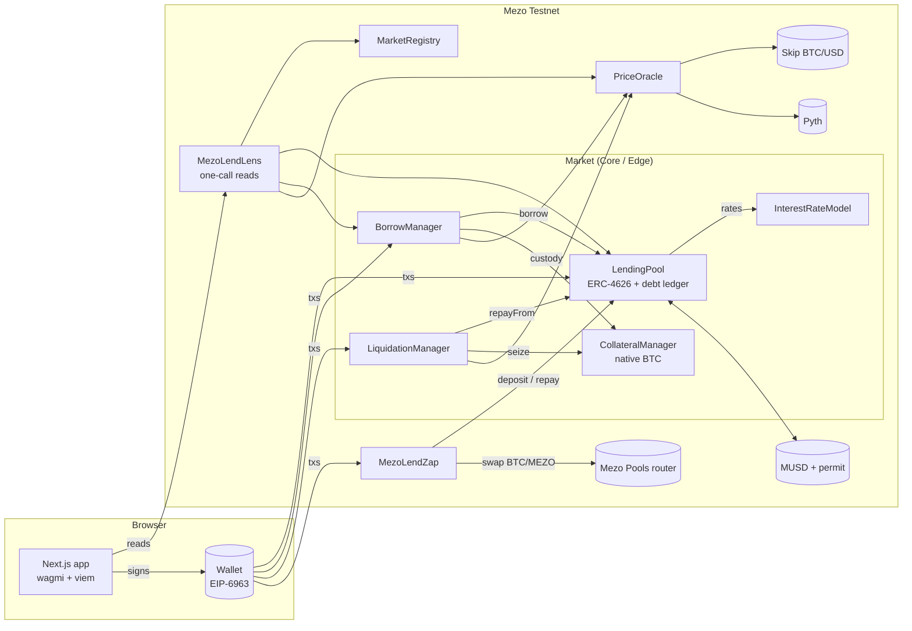

# MezoLend

**Borrow dollars against your bitcoin. Or lend dollars and earn what borrowers pay.**

MezoLend is a lending market for MUSD, Mezo's bitcoin-backed dollar. Borrowers post BTC and borrow MUSD without selling it. Lenders supply MUSD and earn the interest borrowers pay. Balances, interest rates, health checks and liquidations all live in verified contracts on Mezo Testnet; the web app only reads and signs.

- **Live app:** https://mezolend.vercel.app
- **Health check:** https://mezolend.vercel.app/api/health
- **Network:** Mezo Testnet (chain 31611). Test assets have no value.
- **Contracts:** 14, all source-verified on the [Mezo explorer](https://explorer.test.mezo.org/address/0xA890928d677bB01041cd229F9004F09755dac880)
- **Tests:** 78 Foundry tests (unit, fuzz, invariant, audit regressions), all passing

## Why it matters

Holding BTC and needing dollars usually means selling the BTC. Mezo's answer is MUSD, but MUSD is only useful if there are places to put it to work and places to get more of it. MezoLend is both:

- **For BTC holders:** borrow MUSD against BTC from a pool of lenders, at a rate set by demand, and keep exposure to bitcoin. Repay whenever you like and take the BTC back.
- **For MUSD holders:** idle MUSD earns the interest borrowers pay, and can be withdrawn whenever the pool has MUSD that isn't lent out.
- **For Mezo:** every loan and every deposit puts MUSD to work, and every lender earns a real MUSD yield. Swaps go through Mezo Pools, prices come from Mezo's own oracle, and collateral is native BTC.

## Try it in two minutes

1. Add Mezo Testnet to your wallet (the app offers this when you connect) and claim BTC from the [Mezo faucet](https://faucet.test.mezo.org).
2. Open the [home page](https://mezolend.vercel.app). Use **Try a loan** to size a loan against the live BTC price, without connecting anything.
3. **Borrow:** press the calculator's borrow button. The borrow page opens prefilled; confirm one transaction that posts the BTC and borrows the MUSD.
4. **Or lend without holding MUSD:** on [Get MUSD](https://mezolend.vercel.app/swap), enter some BTC, choose "Lend it right away" and confirm. One transaction swaps the BTC for MUSD on Mezo Pools and supplies it to a market.
5. Watch the position on the [Dashboard](https://mezolend.vercel.app/dashboard). Repay with one permit signature on the Borrow page, or with BTC through Get MUSD.

## How it uses Mezo

| Mezo building block | How MezoLend uses it |
| --- | --- |
| **MUSD** | The unit of account. Supply, debt, interest, fees and liquidations are all in MUSD. |
| **MUSD's EIP-2612 permit** | Every action that pulls MUSD takes one transaction with an off-chain signature, with no separate approval: `depositWithPermit`, `repayWithPermit`, `repayAndWithdrawWithPermit`, `liquidateWithPermit`. |
| **Mezo Pools** | `MezoLendZap` swaps BTC or MEZO for MUSD through the Mezo Pools router, then optionally supplies it or repays a loan in the same transaction. A new user goes from faucet BTC to an earning position in one transaction. |
| **Native BTC + its ERC-20 precompile** | Collateral is BTC sent as the transaction value. Nothing to wrap or bridge. The zap trades BTC through the `0x7b7c…0000` precompile. |
| **MEZO precompile permit** | Swapping MEZO in the app also uses a permit signature (domain `MEZO`, v1). |
| **Skip oracle (+ Pyth)** | BTC/USD from Mezo's built-in Skip feed, fresh every block, with Pyth as a fallback. Stale, out-of-bounds or future-dated prices are rejected and risky actions pause. |

## Features

**Lending**
- Two isolated markets, Core (conservative) and Edge (higher yield), each with its own pool, risk limits and rate curve
- ERC-4626 pool shares that grow as interest accrues; earned interest tracked on-chain per lender
- Lend in one permit transaction; withdraw any time up to the pool's idle MUSD

**Borrowing**
- Post BTC and borrow in one transaction; repay, add or withdraw collateral, or close the whole position in one transaction
- The loan meter: debt drawn against collateral value, with the borrowing limit and the liquidation line marked and a hatched preview of the pending action
- Live health factor, liquidation price, interest so far, and a "what if BTC moves" simulator
- Pausing a market never blocks repaying, adding collateral, or withdrawing BTC that backs no debt

**Getting MUSD**
- BTC or MEZO to MUSD through Mezo Pools, with live quotes and a slippage limit
- Three outcomes in one transaction: keep the MUSD, lend it, or repay a loan with the change refunded
- An honest note when the testnet pool price drifts from the oracle

**Liquidations**
- Every open loan listed from on-chain account sets, riskiest first
- Liquidate in one permit transaction with a slippage guard on the BTC received
- 50% close factor, full liquidation for deeply underwater or small loans, bad debt written off against reserves first

**Product**
- A "Try a loan" calculator on the home page using live prices and real market terms
- Dashboard with every position and full on-chain history, including zap swaps
- Markets, market detail and analytics pages with rate curves and history from contract events
- Plain-English contract errors, step-by-step transaction progress with explorer links, notifications
- Works at 360 px phones, tablets and desktop; `/api/health` for monitoring; Vercel Analytics

## Architecture



| Contract | Role |
| --- | --- |
| `LendingPool` | ERC-4626 MUSD vault for lenders plus a borrow-index debt ledger. Per-second interest, reserve factor, origination fee, caps, internal cash accounting, bad-debt write-off (reserves first). Permit entry points. |
| `BorrowManager` | Borrower entry point: deposit, borrow, repay-and-withdraw. Enforces the LTV limit, tracks open accounts on-chain. |
| `CollateralManager` | Holds native BTC per user, per-asset risk settings with `LT × (1 + bonus) < 1` enforced. Keeps the protocol's liquidation cut until claimed. |
| `LiquidationManager` | Permissionless liquidations below health 1.0, close factor, slippage guard, protocol share of the bonus. |
| `InterestRateModel` | Kinked utilization curve. |
| `PriceOracle` | Skip primary, Pyth fallback, staleness, bounds, confidence and clock-drift checks. |
| `MezoLendZap` | Stateless, ownerless Mezo Pools zap: swap, swap-and-supply, swap-and-repay. |
| `MarketRegistry`, `MezoLendLens` | Market directory and the read aggregator that loads a whole market or account in one `eth_call`. |

There is no backend or database. The site reads contract state through the lens and history from contract events via the Mezo explorer API.

## Deployed contracts (Mezo Testnet)

Deployed by `0x7c298d22acc23c5931B3F1d6aB5D9f6Ded85B1b7` at block 16,771,209. All verified.

| Contract | Address |
| --- | --- |
| Market registry | [0xA890928d677bB01041cd229F9004F09755dac880](https://explorer.test.mezo.org/address/0xA890928d677bB01041cd229F9004F09755dac880) |
| Price oracle (Skip + Pyth) | [0x0b5fEf198Ca8768b29d1fdb0cc47d756D309164B](https://explorer.test.mezo.org/address/0x0b5fEf198Ca8768b29d1fdb0cc47d756D309164B) |
| Lens | [0x80d9C7640F9bA51D5499e476e44373caAe51F5Eb](https://explorer.test.mezo.org/address/0x80d9C7640F9bA51D5499e476e44373caAe51F5Eb) |
| Mezo Pools zap | [0xAd79e9E2Ad1828D8ab0215E57801d2ad7894aa46](https://explorer.test.mezo.org/address/0xAd79e9E2Ad1828D8ab0215E57801d2ad7894aa46) |
| Core · LendingPool | [0x207DAa17d31Cb9b832eDADd9DC2a5f2e2C56B089](https://explorer.test.mezo.org/address/0x207DAa17d31Cb9b832eDADd9DC2a5f2e2C56B089) |
| Core · BorrowManager | [0x2aA554B86EC34a813dfBcD6b01F1ce7971Ea0A0B](https://explorer.test.mezo.org/address/0x2aA554B86EC34a813dfBcD6b01F1ce7971Ea0A0B) |
| Core · CollateralManager | [0xfb74f18798adfE321e7cD822a80DF8E9908d5376](https://explorer.test.mezo.org/address/0xfb74f18798adfE321e7cD822a80DF8E9908d5376) |
| Core · LiquidationManager | [0x6F4d25dD6D93b1B980a095A99Da90E0E46E76908](https://explorer.test.mezo.org/address/0x6F4d25dD6D93b1B980a095A99Da90E0E46E76908) |
| Core · InterestRateModel | [0x04229eF57025B9eC7D83F56b84CD075fba0524Dc](https://explorer.test.mezo.org/address/0x04229eF57025B9eC7D83F56b84CD075fba0524Dc) |
| Edge · LendingPool | [0xd3bF758ee72cd48C16EC74D609148F202eb56b7A](https://explorer.test.mezo.org/address/0xd3bF758ee72cd48C16EC74D609148F202eb56b7A) |
| Edge · BorrowManager | [0x6f1e55e83a4e1e380214e73d65Dc664f415c1541](https://explorer.test.mezo.org/address/0x6f1e55e83a4e1e380214e73d65Dc664f415c1541) |
| Edge · CollateralManager | [0xd5Eca5d299244A1CB156ab85515E9436F30F6f73](https://explorer.test.mezo.org/address/0xd5Eca5d299244A1CB156ab85515E9436F30F6f73) |
| Edge · LiquidationManager | [0x47803AA14B1AC2F01159b22Baf50dAA235Ab6D23](https://explorer.test.mezo.org/address/0x47803AA14B1AC2F01159b22Baf50dAA235Ab6D23) |
| Edge · InterestRateModel | [0x5cD82ABd0c899f7c1BE4E485cb2C795833f0b8Eb](https://explorer.test.mezo.org/address/0x5cD82ABd0c899f7c1BE4E485cb2C795833f0b8Eb) |

External: MUSD `0x118917a40FAF1CD7a13dB0Ef56C86De7973Ac503`, Mezo Pools router `0x9a1ff7FE3a0F69959A3fBa1F1e5ee18e1A9CD7E9`, Skip BTC/USD `0x7b7c000000000000000000000000000000000015`.

| Market | Max LTV | Liquidation at | Liquidation bonus | Rate curve | Reserve factor | Origination fee |
| --- | --- | --- | --- | --- | --- | --- |
| **Core** | 70% | 80% | 5% | 1% base, +6% to the 80% kink, +80% above | 10% | 0.10% |
| **Edge** | 78% | 85% | 7.5% | 2% base, +10% to the 85% kink, +120% above | 15% | 0.25% |

Machine-readable files: [`deployments/mezo-testnet.json`](deployments/mezo-testnet.json) (addresses), [`deployments/deploy-log.json`](deployments/deploy-log.json) (all 28 deploy transactions), [`deployments/seed-log.json`](deployments/seed-log.json) (the scripted run) and the two production E2E runs ([run 1](deployments/e2e-prod-run1.json), [run 2](deployments/e2e-prod-run2.json)).

## Real transactions

### Scripted run with four wallets

`web/scripts/seed-demo.mjs` registers the price feed, funds four fresh wallets from the deployer and drives every money path through the deployed contracts. All 20 transactions succeeded.

| What happened | Wallet | Transaction |
| --- | --- | --- |
| Register the BTC/USD feed (Skip primary, Pyth fallback) | deployer | [0xb0f11fea…](https://explorer.test.mezo.org/tx/0xb0f11fea3355cac75de86b04ed26b5e7dcc889aded2f63edc42464c03522038c) |
| BTC → MUSD → Core supply in one transaction (`swapAndSupply`) | ada | [0x0ebaf8e4…](https://explorer.test.mezo.org/tx/0x0ebaf8e48c33277a116fa939812669d7e39cbb3ed6f8aa6edbd8f2be7027c360) |
| Swap BTC for MUSD on Mezo Pools (`swapToMusd`) | ben | [0x8f693535…](https://explorer.test.mezo.org/tx/0x8f693535f1dd2d1732ef79132d69b9f8b230f0934c75c2b6089001d5f70e6394) |
| Supply 250 MUSD to Edge with a permit (`depositWithPermit`) | ben | [0xf139f3fb…](https://explorer.test.mezo.org/tx/0xf139f3fbedb31b16ee91657dbaa87fea031ff999084db0bb147f3dd1a17a6a35) |
| BTC → MUSD → Edge supply (`swapAndSupply`) | deployer | [0xa4aca88d…](https://explorer.test.mezo.org/tx/0xa4aca88d1bd466d8dfdba653fd8d152212956d362f13c3af34b9eb0136352d45) |
| Post 0.004 BTC and borrow 100 MUSD in Core | cleo | [0x2c24969c…](https://explorer.test.mezo.org/tx/0x2c24969c2c66938b4a2fa4e5a1e74a4934170df5d9b3ca61817e9428aaa5bc4e) |
| Post 0.003 BTC and borrow 154.06 MUSD in Edge (near the limit) | dev | [0xc1c999b6…](https://explorer.test.mezo.org/tx/0xc1c999b61e3af0e29041fc3572388037ca27687cae8195ccb5de563faff71cb7) |
| Post 0.0015 BTC and borrow 40 MUSD in Edge | cleo | [0x85c16ca4…](https://explorer.test.mezo.org/tx/0x85c16ca4a2a9579659b44d77625ef87edea736d316d8bb58c5dbef5c7c0d6b6f) |
| Post 0.006 BTC and borrow 180 MUSD in Core | deployer | [0xd6cf3879…](https://explorer.test.mezo.org/tx/0xd6cf3879514750265c854061ef6b3d8bae35d74d1f052de95a995d531e8a9d25) |
| Repay 40 MUSD with a permit (`repayWithPermit`) | cleo | [0x1a84943e…](https://explorer.test.mezo.org/tx/0x1a84943ef422142419403c66e4d918c0d60b9013e9db8da6b0e8bc2acab1cd74) |
| Repay with BTC through Mezo Pools (`swapAndRepay`) | cleo | [0xf7903f5b…](https://explorer.test.mezo.org/tx/0xf7903f5bd09fa0002830f71dda60b569e2535da3fc4b162dd982523841f36576) |
| Withdraw 50 MUSD from Core | ada | [0x73c4f476…](https://explorer.test.mezo.org/tx/0x73c4f476dcb6e9535926512d14ce989ca89ea0b978c917b77402fe7199a9759b) |
| Tighten Edge's BTC risk parameters (stages a liquidation) | deployer | [0x37ddc3e9…](https://explorer.test.mezo.org/tx/0x37ddc3e9abad6bc113bff006d1017acea693cae108f1141601cc880b45db92cb) |
| Liquidate dev's Edge loan with a permit (`liquidateWithPermit`) | ben | [0x9d8fb5f3…](https://explorer.test.mezo.org/tx/0x9d8fb5f34285e4b726627f76c8b5d2c334c2dab3f359fa44ea61b9ab24eec7c9) |
| Restore Edge's BTC risk parameters | deployer | [0x5fca4e69…](https://explorer.test.mezo.org/tx/0x5fca4e69d29c444c9162fd8ff1098a15ac63aa7ac500540c444cff233cdde3ee) |
| Repay in full and withdraw all BTC with a permit (`repayAndWithdrawWithPermit`) | dev | [0xd31e605d…](https://explorer.test.mezo.org/tx/0xd31e605de03bcebfff103e485ce13573873539a71b4c2f2eb53f709b7fd24952) |

BTC's price can't be moved on testnet, so the run (and the end-to-end test below) stage a liquidation by briefly tightening the Edge market's BTC risk parameters, a normal governance lever, and restoring them right after.

### End-to-end test through the live site

`e2e/prod.mjs` opens https://mezolend.vercel.app in Chrome with an injected wallet (EIP-6963) whose signing runs in Node with a funded testnet key, clicks through every user action, waits for the app to report each transaction confirmed, and checks each hash again on the explorer API.

Every step passed on production: 12 of 14 in the first run, and the other two after the fixes below were deployed (the second run repeated connect, borrow, close and the dashboard check). That is 12 transactions confirmed by the explorer and no console errors. The final responsive sweep at 360 px, 414 px and 768 px over all 9 pages found no horizontal scrolling.

| UI action on mezolend.vercel.app | Transaction | Explorer |
| --- | --- | --- |
| Connect a wallet through the connect dialog (EIP-6963) | UI check, no transaction | passed |
| Get MUSD: swap 0.0015 BTC for MUSD on Mezo Pools | [0x941be4c0…](https://explorer.test.mezo.org/tx/0x941be4c0a08b129213ce538fbffa141b57af40975a6250d2916825bc530c4e58) | confirmed |
| Get MUSD: swap 4 MEZO for MUSD with a MEZO permit | [0x8599eac8…](https://explorer.test.mezo.org/tx/0x8599eac8b70ab4437f32083d7a83fe7dd064e57f5b62b84c9f8e38e9f95237d6) | confirmed |
| Lend: lend 50 MUSD in Core with an MUSD permit | [0x03bb52a2…](https://explorer.test.mezo.org/tx/0x03bb52a2d9df69c735deebe18f92c97c5724d6c7deaa3c84e693f681fabdb9a4) | confirmed |
| Lend: withdraw 10 MUSD from Core | [0x98f48f3f…](https://explorer.test.mezo.org/tx/0x98f48f3f78ad95419d6e4996a21dcf527a309fbd9f3e4034735742f742d1da1f) | confirmed |
| Get MUSD: swap 0.0005 BTC and lend it in Edge in one transaction | [0xcc95dbe8…](https://explorer.test.mezo.org/tx/0xcc95dbe8872b3e61df79434a752c8ec3b4329a3bb1a6c49fa9f15a5b049bc6b3) | confirmed |
| Borrow: post 0.003 BTC and borrow 60 MUSD in Core | [0xc889d397…](https://explorer.test.mezo.org/tx/0xc889d3970deda0a13e88b1be324d1848d332ea53909d06a3988a39858a313d29) | confirmed |
| Borrow: repay 20 MUSD with an MUSD permit | [0xa60776fe…](https://explorer.test.mezo.org/tx/0xa60776fec3a4aa3be0f65e995fb3365d3685109792b26cdaef58bb5f7453cecb) | confirmed |
| Collateral: add 0.0005 BTC | [0x2f75ebea…](https://explorer.test.mezo.org/tx/0x2f75ebea8452db1fc312616e5faceb6ba4926626ff8bf43d64aa169dab7e390b) | confirmed |
| Collateral: withdraw 0.0003 BTC | [0x4edc6878…](https://explorer.test.mezo.org/tx/0x4edc6878bb68e1c3a5120583118e74310f8a8268f936a7a7092e5f82ab8bc5b1) | confirmed |
| Get MUSD: repay the Core loan with 0.0002 BTC through Mezo Pools | [0x1a8f34c3…](https://explorer.test.mezo.org/tx/0x1a8f34c38fefa51a21cee93ce44099824c413a3fca8e4f1fec8194cead492010) | confirmed |
| Liquidate: repay an unhealthy Edge loan with an MUSD permit | [0xd0859bcc…](https://explorer.test.mezo.org/tx/0xd0859bcc83a00c04c8199f9d9a1f1ee750a166ecdcf63c573ccdd13c6db633d4) | confirmed |
| Close: repay the Core loan in full and withdraw all BTC (permit) | [0x0e545993…](https://explorer.test.mezo.org/tx/0x0e545993de689cb225f8a6c93aec3cf699222d8ce7f99f09d25da318281107de) | confirmed |
| Dashboard shows swaps, repayments and the liquidation in the history | UI check, no transaction | passed |

The first run found two bugs, both fixed and redeployed before the second run:
- After a full repay or close, the confirmation and its explorer link vanished from the screen.
- With a wallet connected, the header overflowed a 360 px screen by 17 px.

Logs: [run 1](deployments/e2e-prod-run1.json), [run 2](deployments/e2e-prod-run2.json).

## Security review

Every function, state transition and money path was reviewed before this release. For each finding, a proof-of-concept test was written that failed against the old code; then the contract was fixed and the test kept as a regression test (`contracts/test/Audit.t.sol`). This is an internal review by the builders, not an external audit.

| ID | Severity | Finding | Fix | Regression test |
| --- | --- | --- | --- | --- |
| M-01 | Medium | Liquidations pushed the protocol's BTC cut to the treasury. A treasury that can't receive BTC made every liquidation revert (`NativeTransferFailed`), letting bad debt build up. | The cut is credited to `CollateralManager.protocolBalance` and claimed later with `claimProtocolCollateral` (commit `6ea67dd`). | `test_PoC_M01_TreasuryRejectingBtcCannotBlockLiquidations` |
| M-02 | Medium | A pause blocked `withdrawCollateral` and `repayAndWithdraw` for everyone, freezing BTC that backs no debt (`EnforcedPause`). | A pause now only blocks withdrawals from accounts with open debt (`ac49712`). | `test_PoC_M02_DebtFreeCollateralWithdrawableWhilePaused`, `test_PoC_M02_RepayInFullAndWithdrawWhilePaused`, `test_M02_PausedStillBlocksWithdrawalsBackingDebt` |
| L-01 | Low | "Withdraw max" collateral could revert with `InsufficientCollateral`: the maximum rounded the per-token capacity down, then failed its own solvency check by 1 wei. Found by fuzzing. | The maximum is computed as the exact inverse of the check, rounding down at each step (`5d3982e`). | `testFuzz_PoC_L01_MaxCollateralWithdrawNeverReverts`, `test_PoC_L01_MaxWithdrawConcreteCase` |
| L-02 | Low | A feed timestamp in the future counted as fresh until that date, so a stuck feed could keep serving a frozen price. | Prices stamped more than 5 minutes ahead of block time are rejected (`a2094b7`). | `test_PoC_L02_FutureDatedPriceIsRejected`, `test_L02_SmallClockDriftStillAccepted` |

**Checked and safe as designed**
- **Reentrancy.** Reentrancy through the liquidator's BTC payout is blocked: both managers are locked during the callback, and the protocol cut is booked first.
- **Donations.** MUSD sent straight to a pool can't move its share price, because the pool keeps its own cash count.
- **Permit front-running.** Permits are wrapped in `try/catch`, so a signature someone else submits first can't block your transaction (`test_PermitFrontRunDoesNotBlockDeposit`).
- **The zap.** It holds no funds or allowances after any call (fuzzed), takes only registry-listed active markets, and enforces your minimum output and deadline.
- **Rounding.** Every rounding direction favours the pool: debts round up, seizures round down.

**What a contract can't prevent**
- **The admin key.** One deployer key holds the admin and pause roles: oracle, risk parameters, pauses and reserves. Before mainnet these roles belong behind a timelock and a multisig.
- **Price feeds.** MezoLend validates both feeds but trusts what they report. If both are stale, borrowing, withdrawals and liquidations stop until a fresh price returns. Repaying and adding collateral always work.
- **Crashes.** If BTC falls faster than liquidators act, a loan can end up worth less than its debt. Reserves absorb the loss first, then lenders.
- **Liquidity.** Lenders can only withdraw MUSD that isn't lent out. At high utilization the rate curve rises steeply to pull repayments back in.
- **Pool prices.** Mezo Pools prices are only as fair as the pool. Testnet pools aren't arbitraged, so the slippage limit you set is your protection.
- **Outside MezoLend.** MUSD, Mezo itself and phishing front ends are outside its control.

## Run it locally

Requirements: Node 20+, [Foundry](https://book.getfoundry.sh).

```bash
# contracts: build and test
cd contracts
forge install foundry-rs/forge-std OpenZeppelin/openzeppelin-contracts@v5.0.2 --no-git
forge test                         # 78 tests

# web app (points at the deployed testnet contracts)
cd ../web
npm install
npm run dev                        # http://localhost:3000
```

Deploying your own copy:

```bash
# contracts/.env (gitignored): DEPLOYER_PRIVATE_KEY=0x... (testnet only)
cd contracts
forge script script/Deploy.s.sol --rpc-url https://rpc.test.mezo.org --broadcast --slow \
  --gas-estimate-multiplier 150 --verify --verifier blockscout \
  --verifier-url https://api.explorer.test.mezo.org/api/
cd ../web
node scripts/seed-demo.mjs         # registers the oracle feed on-chain, then the 4-wallet run
npm run sync                       # copies ABIs and addresses into the app
cd .. && bash scripts/deploy-web.sh   # Vercel production deploy from a clean copy (no .env files)
```

Notes from building on Mezo:
- **Compiler settings.** Contracts compile with `evm_version = london` and OpenZeppelin 5.0.2.
- **Oracle setup.** Mezo's Skip oracle is a precompile that forge can't simulate, so the feed is registered on-chain by the seed script.
- **Gas.** RPC gas estimates can run low, so the app pads every estimate and applies a per-action gas floor.

End-to-end test against production: `cd e2e && npm install && node prod.mjs` (needs `DEMO_E2E_KEY` and `DEPLOYER_PRIVATE_KEY` in `contracts/.env`, testnet keys only).

Liquidation keeper: `cd web && DRY_RUN=1 npm run keeper` lists liquidatable loans; with `KEEPER_PRIVATE_KEY` set it liquidates them.

## Repository layout

```
contracts/    Foundry project: src/, test/ (78 tests), script/Deploy.s.sol
web/          Next.js app: src/app (routes + /api/health), src/components, src/hooks, src/lib, scripts/
e2e/          Production end-to-end test (Playwright + real testnet wallet)
deployments/  Addresses, deploy transactions, the seed run and the e2e run
scripts/      deploy-web.sh
```

## Roadmap

1. **Governance hardening:** move admin and pause roles behind a timelock and multisig, and add an on-chain cap on how far risk parameters can move per change.
2. **More collateral:** list Mezo's other assets (for example MEZO, and the BTC-backed tokens Mezo supports) as collateral, each with its own risk settings.
3. **Liquidation infrastructure:** a hosted keeper and a flash-swap liquidation path through Mezo Pools, so liquidators don't need to hold MUSD.
4. **Alerts:** push and email alerts when a loan's health falls, plus one-click "add collateral" from the alert.
5. **External audit and mainnet launch,** with conservative caps that rise over time.
